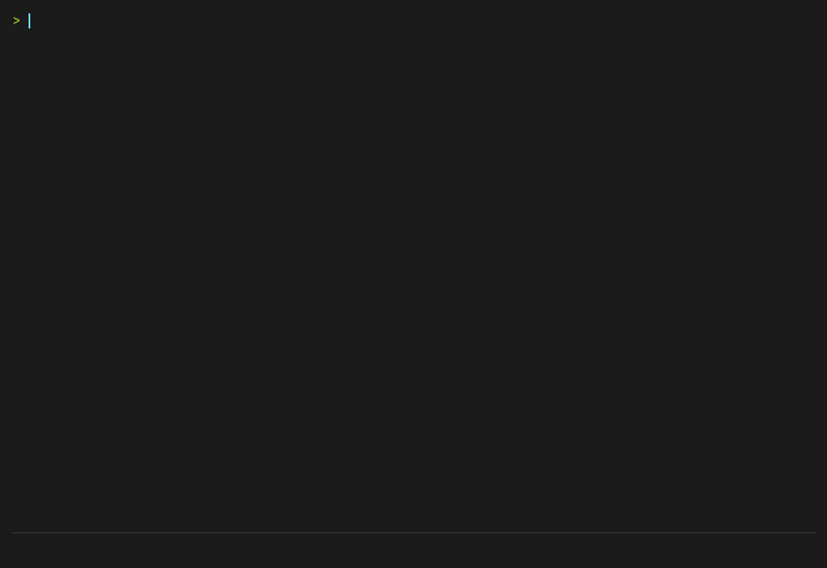

<p align="center"></p>

# mdv

My notes are Markdown files, and many of them have math in them. I wanted to read them in the terminal, in a pane next to my editor, with the equations drawn as equations instead of raw LaTeX. mdv does that. Open a note, keep writing in any editor, and the view redraws each time you save.



It is one small binary with no runtime. It also has its own editor, so you can fix a typo without leaving.

## Install

Linux (x64) and macOS (Apple silicon and Intel), into `~/.local/bin`:

```bash
curl -fsSL https://raw.githubusercontent.com/Satheeshsk369/mdv/main/scripts/install.sh | sh
```

Windows (x64), into `%LOCALAPPDATA%\mdv`, added to your `PATH`:

```powershell
irm https://raw.githubusercontent.com/Satheeshsk369/mdv/main/scripts/install.ps1 | iex
```

Or download a binary from the [releases page](https://github.com/Satheeshsk369/mdv/releases).

## Use

```bash
mdv                     # pick a Markdown file in this folder
mdv notes.md            # open it; the view reloads when the file changes
mdv notes.md:42         # open at line 42
mdv notes.md -s         # print the rendered text and exit
cat notes.md | mdv      # render stdin
```

| Option | Effect |
| :--- | :--- |
| `-s` | Print to stdout |
| `-p` | Plain text, no colour (implies `-s`) |
| `-nw` | No wrapping |
| `-W <cols>` | Wrap width |
| `-h` / `-v` | Help / version |

When the file changes on disk, mdv scrolls to the first changed line and marks it.

## Keys

Press `Space` for a menu of everything below.

| Key | Action |
| :--- | :--- |
| `↓` `↑` | Scroll; faster while held |
| `PgDn` `PgUp` | Half page |
| `Home` `End` | Top / bottom |
| `←` `→` | Scroll sideways when wrapping is off |
| `w` | Toggle wrapping |
| `:` | Go to a source line |
| `/` `n` `N` `Esc` | Search, next, previous, clear |
| `Tab` `t` | Outline of headings |
| `h` | Highlight the block under the cursor |
| `c` | Theme: the view changes as you move through the list; `Enter` keeps it, `Esc` goes back |
| `o` | Files in this folder |
| `e` | Edit in mdv, with a live preview |
| `E` | Open `$EDITOR` at this line |
| `y` | Copy the document to the clipboard |
| `?` | Help |
| `q` `Ctrl+C` | Quit |

The theme you keep is saved in `~/.config/mdv/theme`.

## Editor

`e` opens the source beside the rendered view (above it on narrow screens), starting at the highlighted block. There are no modes: type to insert. `Enter` keeps the indentation and continues lists and quotes. `Ctrl+O` shows every command.

| Key | Action |
| :--- | :--- |
| `Ctrl+S` | Save |
| `Ctrl+Z` / `Ctrl+Y` | Undo / redo |
| `Ctrl+F` / `Ctrl+N` | Find / next match |
| `Ctrl+E` | Replace all |
| `Ctrl+G` | Go to line |
| `Shift` + arrows, `Ctrl+A` | Select |
| `Ctrl+←` `Ctrl+→` | Move by word |
| `Ctrl+Home` `Ctrl+End` | Start / end of file |
| `Ctrl+C` `Ctrl+X` `Ctrl+V` | Copy, cut, paste (the whole line when nothing is selected) |
| `Ctrl+K` / `Ctrl+D` | Delete / duplicate lines |
| `Alt+↑` `Alt+↓` | Move lines up / down |
| `Tab` / `Shift+Tab` | Indent / outdent |
| `Ctrl+H` | Highlight the block in both panes |
| `Ctrl+W` | Toggle wrapping |
| `Ctrl+R` | Hide or show the preview |
| `Esc` | Close (press twice to drop unsaved changes) |
| `Ctrl+Q` | Quit mdv |

Brackets and quotes close themselves. With text selected, typing `*`, `_`, `~` or `$` wraps it. The mouse works too: click to move, drag to select, click the preview to jump to that line.

## What it renders

Headings, paragraphs, lists, task lists, block quotes, tables, code blocks with syntax colours, links, images, footnotes, YAML front matter, and the GitHub callouts (`[!NOTE]`, `[!TIP]`, `[!WARNING]`, `[!IMPORTANT]`, `[!CAUTION]`).

Math goes between `$…$` or `\(…\)` inline and `$$…$$`, `\[…\]` or a ```` ```math ```` block for display. Display math is drawn in two dimensions: fractions, roots, sums, integrals, limits, matrices, cases and aligned equations. Inline math becomes Unicode on one line, so `$x_i^2$` reads as xᵢ².

It runs on Linux, macOS, Windows (Windows Terminal or any console with VT support) and the BSDs.

## Build

Needs [C3 0.8.5](https://github.com/c3lang/c3c/releases/tag/v0.8.5).

```bash
git clone https://github.com/Satheeshsk369/mdv && cd mdv
make            # build/mdv
make install    # copy it to ~/.local/bin
make test       # unit tests
make check      # compare rendered output and screens with test/golden
make golden     # accept new output after an intended change
```

`make check` runs the viewer without a terminal. `MDV_KEYS` holds one key per line (tmux names like `Down`, `C-s`, `S-Right`, raw escape sequences, `resize:70x20`, or `!command`), `MDV_SIZE` sets the screen (default `100x30`), and mdv prints the last frame. `scripts/demo.py` uses the same mode to redraw `assets/demo.gif` from `assets/demo.md`.

| Folder | What is in it |
| :--- | :--- |
| `src/app` | Command line, viewer, keys, editor, outline, file tree |
| `src/parser`, `src/ast` | Markdown to blocks and spans |
| `src/render` | Blocks to terminal lines, colours and themes |
| `src/tex` | LaTeX to 2D boxes and to inline Unicode |
| `src/sys` | Terminal input and output for each platform |
| `scripts` | Install scripts and the demo recorder |
